# Cochera Los Ángeles — Sistema de Gestión y Control Interno

Sistema de escritorio en **Java** para la administración, control vehicular, tarificación por bloques horarios, emisión de tickets y auditoría de caja de estacionamiento.

---

# 1. Identificación y formulación del problema

## 1.1 Situación problemática

En el sector de servicios de estacionamiento y cocheras vehiculares (como la empresa *Representaciones e Inversiones Los Ángeles S.A.C.*), la gestión operativa tradicional basada en cuadernos manuales o registros informales enfrenta graves deficiencias:

1. **Falta de exactitud en el cómputo de tiempos y tarifas:** El cobro depende de cálculos manuales de horas y minutos por parte del operario, generando cobros erróneos, pérdida de ingresos por omisión de horas extra o desacuerdos con los conductores respecto a las horas de tolerancia/gracia.
2. **Vulnerabilidad en el control de caja y traslape de turnos:** Al no existir un mecanismo estricto de arqueo de caja (conteo ciego), surgen descuadres entre el dinero en efectivo recaudado y los registros de salida. Además, cuando un vehículo ingresa en el turno de un cajero y sale en el turno de otro, el control manual dificulta atribuir la recaudación de manera transparente.
3. **Pérdida de trazabilidad de los vehículos dentro del local:** La imposibilidad de conocer en tiempo real la cantidad de vehículos estacionados, su tiempo de permanencia o alertas de vehículos abandonados (+12 o +24 horas) incrementa los riesgos de seguridad y desorden vehicular.
4. **Emisión precaria o nula de comprobantes:** La ausencia de tickets estandarizados con identificadores únicos y códigos de barras dificulta la validación rápida de salida y propicia duplicidad de registros o evasión de pagos.

## 1.2 Formulación

> **¿De qué manera el desarrollo e implementación de un sistema de escritorio orientado a objetos (Java) optimiza el control de ingresos/salidas vehiculares, el cálculo tarifario y la conciliación de caja en la Cochera Los Ángeles?**

## 1.3 Diagrama de Ishikawa

A continuación se representa la relación causa-efecto de la problemática operativa central mediante el diagrama de Ishikawa (Causa-Efecto):

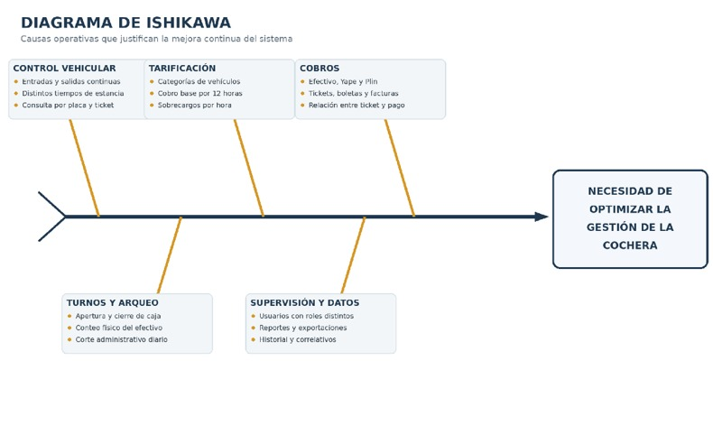
---

## 1.4 Diagrama de Clases

El diseño estructural del dominio y de los servicios del sistema se encuentra modelado en la siguiente arquitectura de clases:

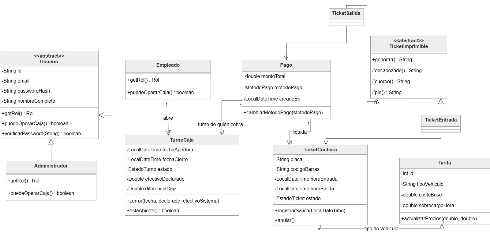


### Interpretación

El diagrama de clases modela el dominio del problema aplicando rigurosamente los principios de la **Programación Orientada a Objetos (POO)**:

1. **Herencia y Polimorfismo:**
   * La clase abstracta `Usuario` centraliza credenciales, autenticación por hash SHA-256 y datos personales, especializándose en `Empleado` (habilitado para operar turnos y cajas) y `Administrador` (enfocado en auditoría, configuración de tarifas y corte global).
   * La clase abstracta `TicketImprimible` define el método plantilla (*Template Method*) `generar()` subdividido en `encabezado()`, `cuerpo()` y `pie()`, especializándose polimórficamente en `TicketEntrada` y `TicketSalida`.
   * La interfaz `Impresora` desacopla el destino físico de impresión (`ImpresoraVentana`, `ImpresoraTermicaConsola`, `ImpresoraArchivo`).

2. **Encapsulamiento y Reglas de Negocio:**
   * `TurnoCaja`: Mantiene estados cerrados y abiertos, garantizando que el cierre solo ocurra mediante el método `cerrar()`, registrando el monto declarado por el usuario y contrastándolo contra el efectivo del sistema para calcular `diferenciaCaja`.
   * `Tarifa`: Protege los valores monetarios impidiendo costos base o sobrecargos negativos mediante validaciones internas.
   * `TicketCochera`: Encapsula los estados (`EN_CURSO`, `PAGADO`, `ANULADO`), controlando la asignación del correlativo único y hora de ingreso/salida.

3. **Desacoplamiento y Relaciones:**
   * La clase `Pago` asocia el `TicketCochera` con el `TurnoCaja` del empleado que realiza el cobro efectivo, resolviendo el problema de **traslape de turnos** (el ingreso puede registrarse en un turno y el cobro liquidarse en otro).

---

# 2. Objetivos y alcance

## 2.1 Objetivo general

Desarrollar un sistema de información de escritorio robusto y modular en **Java**, fundamentado en la Programación Orientada a Objetos y patrones de arquitectura por capas, que automatice el control de acceso vehicular, el cálculo dinámico de tarifas por bloques horarios, la emisión de tickets térmicos y la auditoría de turnos de caja en la **Cochera Los Ángeles**.

## 2.2 Objetivos específicos

1. **Automatizar el registro de ingresos (Check-in):** Capturar y formatear automáticamente la placa vehicular bajo estándar nacional (`ABC-123`), evitando duplicidad de ingresos activos y emitiendo un ticket de control con código de barras legible (`TK-AAAA-NNNNNN`).
2. **Implementar el cálculo exacto de tarifas (Check-out):** Computar la permanencia vehicular basada en bloques de 12 horas, tolerancia de gracia de 30 minutos y liquidación fraccionada de horas adicionales con tope máximo, admitiendo múltiples métodos de pago (Efectivo, Yape, Plin) y cálculo de vuelto.
3. **Garantizar el control y cuadre de caja:** Proporcionar a los empleados apertura y cierre de turno mediante arqueo ciego, calculando discrepancias en tiempo real entre el dinero contado y el flujo registrado en el sistema.
4. **Monitorear en tiempo real la ocupación:** Visualizar vehículos dentro de las instalaciones mediante indicadores visuales de semáforo (`OK`, `POR VENCER`, `+12H`) para una oportuna gestión de espacios y detección de abandono.
5. **Facilitar la administración y reportería:** Ofrecer a los administradores un panel de métricas diarias (KPIs), gráfico horario de recaudación, corte diario operativo a las 2:00 PM, auditoría de turnos anteriores, anulación justificada de tickets y exportación de data histórica a formato CSV/Excel.

---

# 3. Arquitectura y Módulos del Sistema

```
src/cochera/
├── modelo/      → Entidades del dominio (Usuario, Empleado, Administrador, Tarifa, TicketCochera, TurnoCaja, Pago)
├── datos/       → BaseDatos en memoria concurrente y DatosIniciales de prueba
├── servicio/    → Lógica de negocio (CalculadoraTarifa, CheckinServicio, CheckoutServicio, TurnoServicio, etc.)
├── dto/         → Objetos de transferencia de datos (KPIs, reportes, auditoría)
├── impresion/   → Generador de tickets para impresoras térmicas de 58 mm
├── gui/         → Formularios NetBeans Swing (JFrame, JPanel, JDialog)
├── vista/       → Menús e interfaz para consola de comandos (CLI)
├── util/        → Herramientas de formateo (Dinero, Fechas, Placas, Reloj simulador)
└── prueba/      → Pruebas de verificación de cálculo tarifario y flujo operativo
```

## 3.1 Interfaces y Vistas del Sistema

| Módulo / Pantalla | Vista de la interfaz |
|---|---|
| **Inicio de Sesión** | 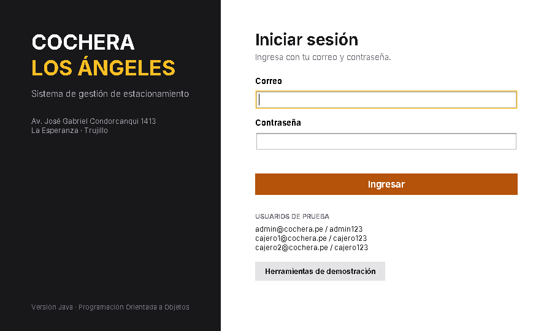 |
| **Apertura de Turno** |  |
| **Check-in (Entrada)** | 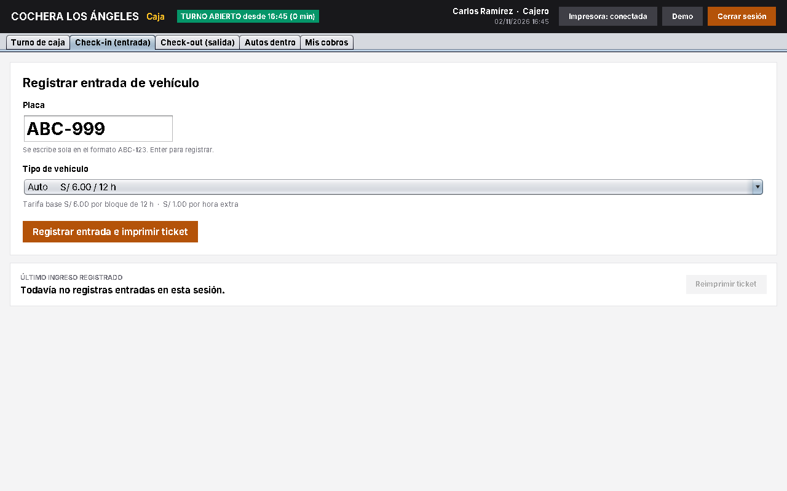 |
| **Ticket de Entrada** | 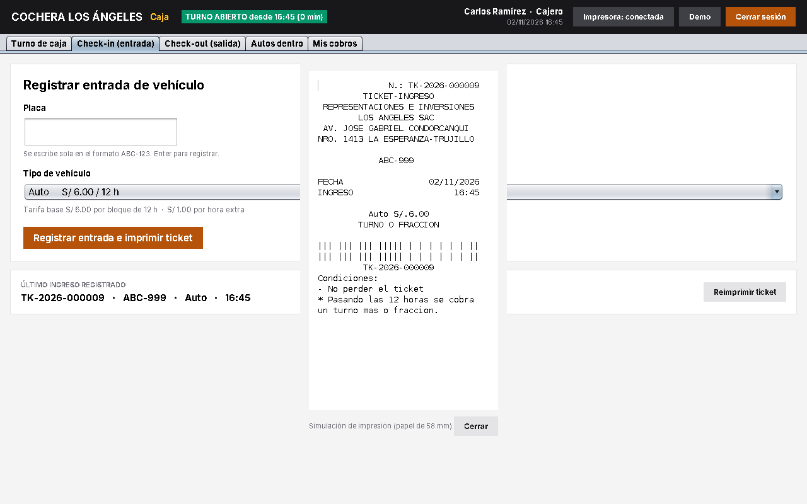 |
| **Check-out (Cobro y Vuelto)** | 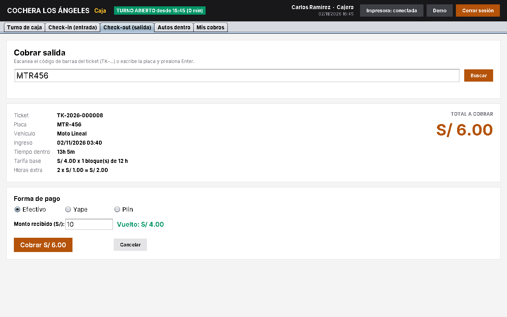 |
| **Ticket de Salida** | 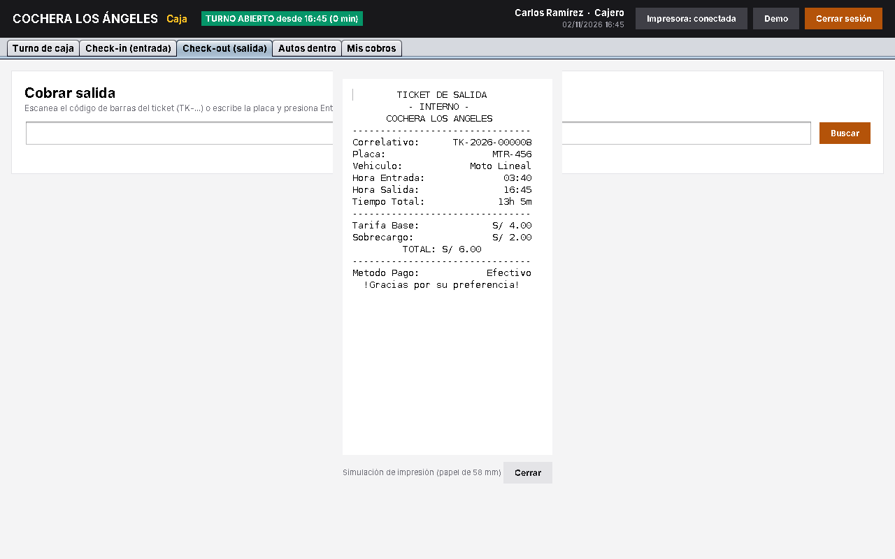 |
| **Vehículos dentro en vivo** | 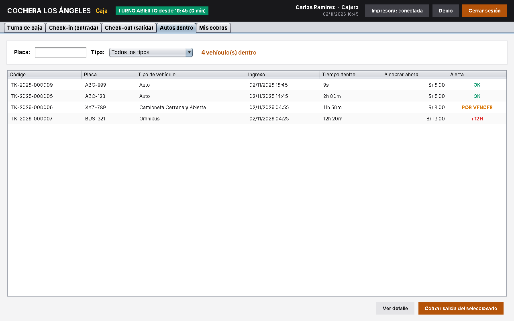 |
| **Arqueo y Cierre de Turno** | 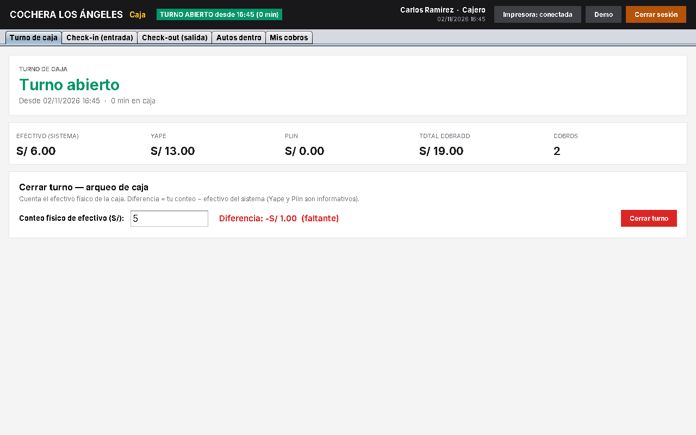 |
| **Resumen Diario y Gráficos (Admin)** | 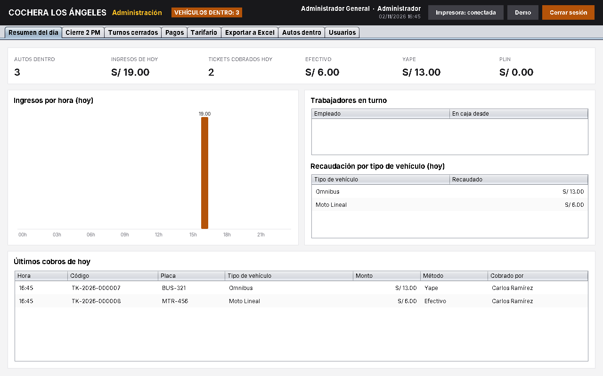 |
| **Cierre Diario 2:00 PM** | 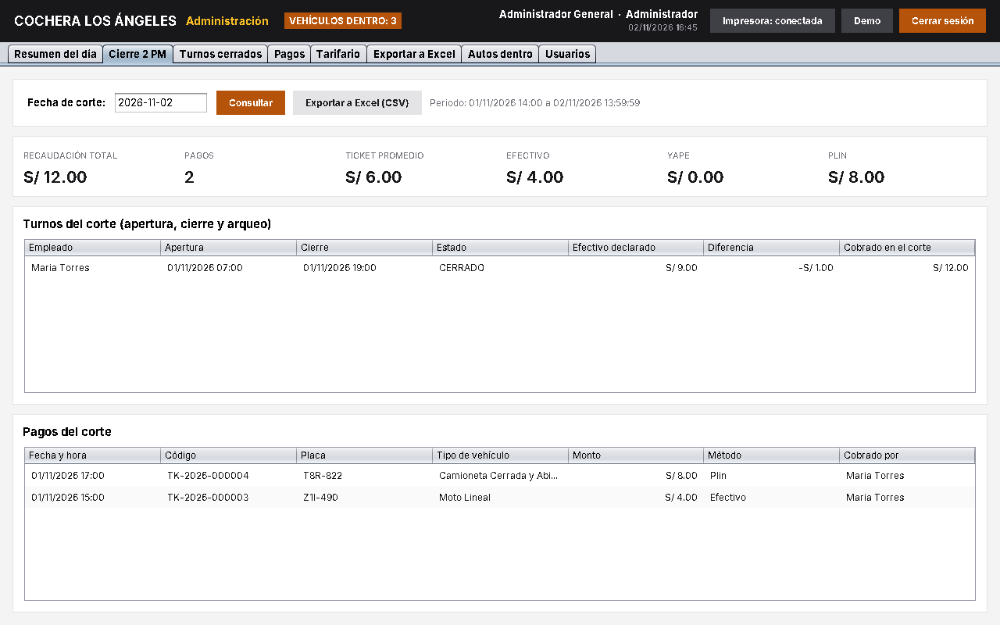 |
| **Auditoría de Turnos Pasados** | 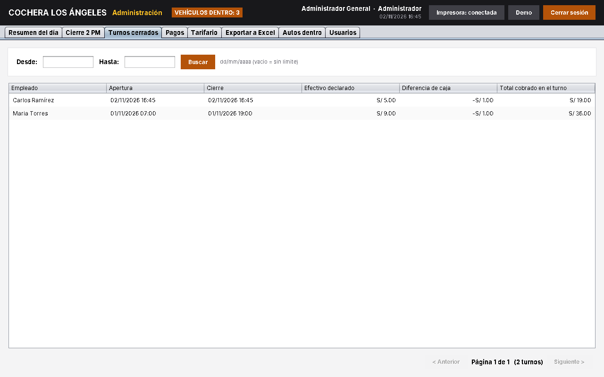 |
| **Exportación a CSV / Excel** | 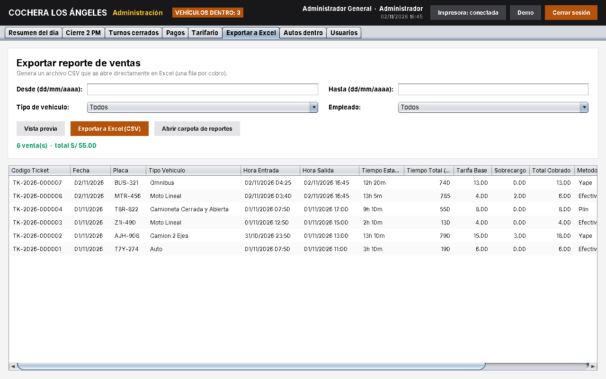 |

